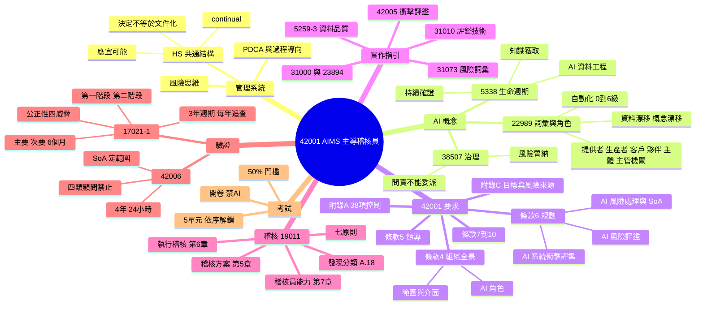

# 全課程心智圖（一頁看完）

> 用 Mermaid mindmap 畫出整門課的骨架。GitHub 與多數 Markdown 編輯器可直接顯示；看不到圖時，下方有文字版。

## 文字版

- **管理系統**：HS 共通結構（應、宜、可、能；決定不等於文件化；continual）、PDCA 與過程導向、風險思維
- **AI 概念**：22989 詞彙與角色（六角色、自動化 0～6 級、資料與概念漂移）；38507 治理（問責不能委派、風險胃納）；5338 生命週期（知識獲取、AI 資料工程、持續確證）
- **42001 要求**：條款 4（AI 角色、範圍與介面）、條款 5、條款 6（AI 風險評鑑、處理與 SoA、衝擊評鑑）、條款 7～10、附錄 A 38 項、附錄 C
- **實作指引**：31073、31000＋23894、31010、42005、5259-3
- **稽核 19011**：七原則、第 5 章方案、第 6 章執行、第 7 章能力、A.18 發現
- **驗證**：17021-1（3 年週期、每年追查、兩階段、主要次要與 6 個月、四威脅）；42006（四類顧問禁止、4 年與 24 小時、SoA 定範圍）
- **考試**：5 單元依序解鎖、50% 門檻、開卷但禁止 AI

每個節點的細節見 [課程資源筆記索引](../01_核心觀念/課程資源筆記/README.md)。
