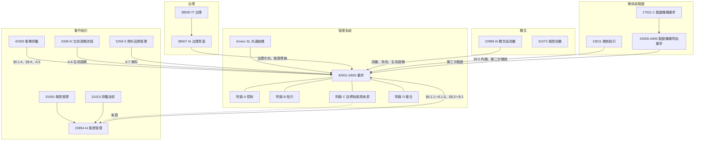

# 標準關係地圖與證據鏈練習

> 把課程用到的十幾份標準放在一張圖上，再用智腕科技走一次「從 §4 一路追到 §10」的證據鏈。
> 標準細節見 [課程資源筆記](課程資源筆記/README.md)；法規面見 [法規與標準總覽](法規與標準總覽.md)。

## 1. 標準關係地圖



**一句話記住層次**：38507 決定「要不要、能接受多少」；42001 要求「建立制度」；23894、42005、5338、5259 教「怎麼做」；19011 教「怎麼查」；17021-1 與 42006 規定「誰能發證、怎麼發」。

## 2. 證據鏈練習：智腕科技 AI-002 健康風險預警

照順序填空，每一格都要能說出 **文件或紀錄編號**。先自己填，再展開對照。

| 步驟 | 條款 | 問題 | 你的答案 |
|---|---|---|---|
| ① | §4.1 | 哪個內外部議題讓 AI-002 變重要？ | |
| ② | §4.2 | 哪個關注方需求跟它有關？ | |
| ③ | §4.3 | AI-002 在範圍內嗎？介面有哪些？ | |
| ④ | 5338 6.4.2、6.4.3 | 利害關係人需要（SN）怎麼變成系統需求（SR）？ | |
| ⑤ | §6.1.2 | 對應的風險編號與等級？ | |
| ⑥ | §6.1.4 | 衝擊評鑑報告與衝擊項目？ | |
| ⑦ | §6.1.3 | 處理選項、對應附錄 A 控制、SoA 項目？ | |
| ⑧ | §6.2 | 對應的 AI 目標或 KRI？ | |
| ⑨ | §8.1、A.6.2.5 | 上線前的核准證據？ | |
| ⑩ | A.6.2.6、5338 6.4.14 | 上線後怎麼監控？紀錄在哪？ | |
| ⑪ | §9.2 | 內稽抽查了什麼？ | |
| ⑫ | §9.3 | 管理審查有沒有討論？ | |
| ⑬ | §10.2 | 發現問題後的矯正措施與有效性查證？ | |

<details><summary>參考答案（依本 repo 作業）</summary>

| 步驟 | 參考答案 |
|---|---|
| ① | 消費者健康管理需求、AI 功能成市場標準；健康敏感個資（FRM-001-01） |
| ② | 使用者期待預警可信、不延誤就醫（IP-003）；族群公平（IP-005） |
| ③ | 在範圍內（FRM-001-05）；介面：雲端推論服務、手錶端模型、App 通知 |
| ④ | FRM-010-02 的 SN-xxx → SR-xxx（例如 SR-07 族群敏感度） |
| ⑤ | RC-003 誤報漏報（高）、RC-006 族群敏感度、RC-007 醫材定位（極高）、RC-008 誤報負擔、RC-009 感測器漂移（AIMS-PRO-002 附件 A） |
| ⑥ | AIA-2026-001（AIMS-FRM-006-07）IM-01～IM-12 |
| ⑦ | 降低後果、降低可能性；A.5、A.6.2.4、A.6.2.6、A.7.4、A.8.2；SoA 摘錄（PRO-002 附件 B） |
| ⑧ | FRM-003-01 AI 目標管理表；KRI 例如漏報率、分族群敏感度 |
| ⑨ | AIGC-2026-05 有條件通過、上線條件 C1～C6、2027/01 最終核准（時間軸） |
| ⑩ | 漂移監控、KRI 月報；依 5338 應有確證日誌 |
| ⑪ | 首次內部稽核 2027/01（時間軸），單元 9 作業可補 |
| ⑫ | 2027/01/31 首次管理審查（E4） |
| ⑬ | 單元 10 作業可補；可參考 [模擬稽核演練](../03_考試準備/模擬稽核演練_智腕科技第二階段.md) 的 RC-006 監控不符合 |

</details>

## 3. 稽核員的反向追溯

稽核員常 **反過來追**：從一筆現場紀錄往回追到風險與政策，看有沒有斷鏈。

```
一筆漂移告警紀錄
  → 告警門檻依據哪份文件？（A.6.2.6 監控程序）
  → 門檻是依哪個風險訂的？（RC-009）
  → 風險處理計畫有沒有寫這個控制？（PRO-002 附件 A）
  → SoA 有沒有列這個控制？（A.6.2.6）
  → 有沒有對應的 AI 目標或 KRI？（FRM-003-01）
  → 管理審查看過趨勢嗎？（§9.3 輸入 d）
```

**斷鏈就是發現**：例如紀錄存在但找不到門檻依據，或風險有寫控制但現場沒有紀錄。
