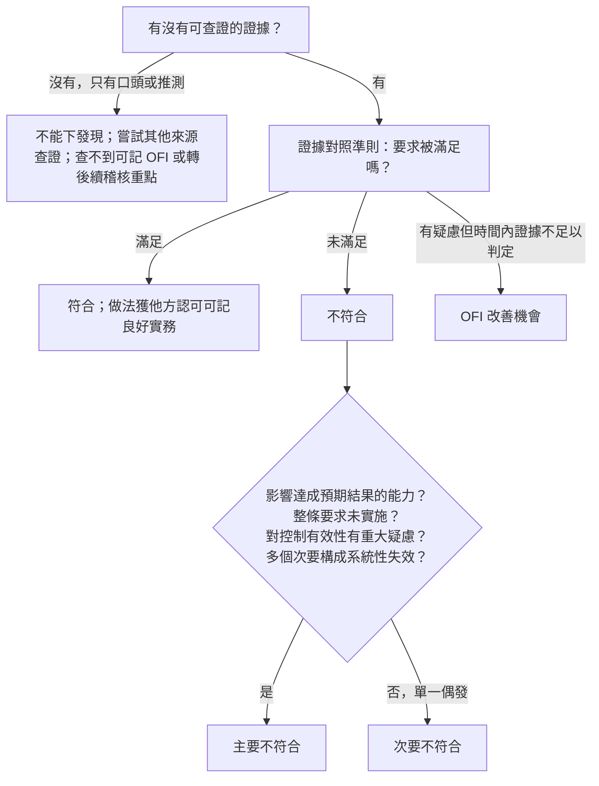

# 情境題決策樹與 30 題速練（考試單元 4、5）

> 考試單元 4（14 題、60 分）與單元 5（8 題、50 分）是情境題，佔總題數一半以上。
> 這份用 **決策樹** 把判斷方式固定下來，再用 30 個短情境練習。情境全部原創，產業刻意混搭，不只智腕科技。

## 1. 三棵決策樹

### 樹一：這是哪一種發現？

### 樹二：稽核中出狀況怎麼辦？

| 狀況 | 第一步 | 接著 |
|---|---|---|
| 立即且重大風險（安全、資料外洩進行中） | **立刻告知受稽方** | 適當時告知委託方或驗證機構；法規強制通報時可能需要正式溝通 |
| 稽核目標無法達成 | **組長** 報告委託方與受稽方（驗證：客戶與驗證機構） | 改計畫、改目標或範圍、或終止 |
| 範圍外的問題 | 記錄並 **告知組長** | 組長決定是否與委託方、受稽方溝通 |
| 文件拿不到 | 組長告知方案管理者與受稽方 | 決定繼續或暫停 |
| 受稽方拒絕配合 | 記錄、告知組長 | 可能影響目標，組長溝通，必要時終止 |
| 利益衝突或能力不足被發現 | 告知組長 | 改組前先與相關方共同解決 |
| 時間不夠 | 告知組長 | 調整計畫；報告記錄偏差與未涵蓋領域 |

### 樹三：稽核員可以說什麼？

| 可以 | 不可以 |
|---|---|
| 說明要求的意圖 | 推薦特定工具、方案、顧問 |
| 指出改善機會 | 替受稽方寫程序或矯正措施 |
| 解釋發現與證據 | 因為對方施壓就撤銷或降級發現 |
| 說明後續流程、申訴與抱怨管道 | 承諾一定會發證 |

## 2. 30 題速練

> 每題寫下：**發現類型 or 正確行動 ＋ 一句理由**。答案在題組最後。

### A. 發現分類（1～12）

1. 某銀行的信用評分 AI，程序規定每季做公平性測試。抽 4 季，只有 1 季有紀錄，負責人說另外 3 季「有做但沒存檔」。
2. 某醫院影像 AI，程序規定模型更新前要做臨床確證。抽 10 次更新，10 次都有確證報告與簽核。報告格式還被衛生主管機關拿去當範本。
3. 某物流公司 AIMS 範圍聲明寫「全公司所有 AI 系統」，但現場發現倉儲機器人的路徑規劃 AI 沒有登錄在 AI 系統清冊，也沒有任何風險評鑑。
4. 某電商推薦系統，SoA 列 A.6.2.8 事件日誌「已實施」。現場查看，日誌只保留 3 天，程序規定保留 90 天。
5. 某保險公司理賠 AI，管理審查紀錄存在，但輸入只有「稽核結果」，沒有關注方需求變化、內外部議題變化等。
6. 某工廠瑕疵檢測 AI，你覺得測試集可能太小，但現場拿不到統計方法的說明，無法判斷是否足夠。
7. 某新創公司沒有任何內部稽核紀錄，AIMS 已運作 14 個月。
8. 某客服聊天機器人，告知使用者「正在與 AI 互動」的文字只出現在網站使用條款第 12 頁，聊天畫面沒有。
9. 某人資篩選 AI，抽 5 位招募專員，5 位都不知道公司有 AI 疑慮通報管道。
10. 某智慧電網 AI，三個不同部門的模型都沒有做變更前的衝擊評鑑重評，每個部門各 1 件。
11. 某車廠自駕資料標註外包，合約有保密條款，但沒有規定標註品質要求與抽檢。
12. 某公司 AI 政策 1 份，核准日期晚於公告日期 2 天。

### B. 稽核中的行動（13～22）

13. 你在資料中心看到伺服器機櫃冒煙，受稽方人員沒注意。
14. 受稽方經理說：「這些紀錄是機密，你只能聽我口述。」
15. 你發現受稽方另一個 **不在範圍內** 的事業部，用同一份訓練資料做了未經評估的臉部辨識。
16. 你是技術專家，發現模型評估指標用錯了。
17. 受稽方翻譯一直把你的問題「簡化」，你懷疑受訪者沒聽到原意。
18. 稽核第二天，你發現組員曾在受稽方任職，兩年前才離職，負責的就是今天要稽核的流程。
19. 受稽方送你一張高級餐廳的餐券表示感謝。
20. 原定 3 天，第 2 天下午你發現 AI 系統清冊比申請時多了 6 套。
21. 受稽方要求你把查檢表先寄給他們準備。
22. 見習稽核員在訪談中說：「你們這樣做一定會被開主要不符合。」

### C. 結束與報告（23～30）

23. 結束會議時，受稽方總經理要求把一件主要不符合改成次要，「不然董事會那關過不了」。
24. 結束會議後，受稽方寄來新證據，證明那件不符合當時其實有紀錄，只是放在另一個系統。
25. 你的報告寫好了，受稽方要求先讓他們修改用詞再定稿。
26. 驗證稽核結束，組長在報告寫「建議授與驗證」，客戶問：「所以我們拿到證書了？」
27. 客戶不服驗證機構「暫時終止驗證」的決定。
28. 某消費者向驗證機構投訴：某已驗證公司的 AI 客服一直誤判退款資格。
29. 主要不符合在第二階段後 5 個月完成矯正，並經查證有效。
30. 內部稽核報告列了改善建議，受稽部門主管說不想照做。

答案

| # | 答案 | 理由 |
|---|---|---|
| 1 | 不符合，可能主要 | 「有做沒存檔」不能當證據；4 季缺 3 季，系統性 |
| 2 | 符合；可記良好實務 | 有證據、做法被他方認可 |
| 3 | 主要不符合 | 範圍內 AI 系統完全沒有風險評鑑，涉及 §4.3、§6.1.2，系統性 |
| 4 | 次要不符合（視情況） | 控制有但不符程序；SoA 狀態失真 |
| 5 | 不符合（§9.3.2 輸入不完整） | 通常次要；若管理審查完全流於形式可主張主要 |
| 6 | OFI 或轉後續稽核重點 | 有疑慮但證據不足以判定 |
| 7 | 主要不符合 | §9.2 整條要求未實施 |
| 8 | 不符合（A.8.2） | 資訊要能讓使用者在互動時理解；等級依影響判斷 |
| 9 | 不符合（A.3.3、§7.3） | 5 位全部不知道，系統性，傾向主要 |
| 10 | 可升級主要 | 同一要求多個次要構成系統性失效 |
| 11 | 不符合（A.10.3） | 供應者流程未確保符合負責任開發 |
| 12 | 次要不符合（§7.5.2） | 單一文件、偶發 |
| 13 | 立刻告知受稽方 | 立即重大風險，人身安全優先 |
| 14 | 記錄、告知組長；說明保密承諾，請求檢視；仍拒絕可能影響目標 | 口頭不能當證據 |
| 15 | 記錄並告知組長 | 範圍外議題，由組長決定溝通 |
| 16 | 告訴稽核員，由稽核員查證並判斷 | 技術專家不擔任稽核員 |
| 17 | 告知組長；要求確認翻譯或改用其他方式查證 | 翻譯不得對稽核造成不當影響 |
| 18 | 告知組長；改指派前先與相關方共同解決 | 利益衝突；獨立性 |
| 19 | 婉拒 | 正直、公正性 |
| 20 | 告知組長；組長與受稽方、驗證機構溝通範圍與時間 | 範圍或時間可能需要調整 |
| 21 | 依情況可提供稽核計畫；查檢表不限制範圍 | 計畫要事先溝通；不要把查檢表當考卷 |
| 22 | 組長或評估員私下指導 | 稽核員不預告結論、不施壓；見習者由評估員負責 |
| 23 | 不改；說明理由；分歧記錄並提交驗證機構 | 依證據判定 |
| 24 | 交給驗證機構依程序評估；必要時修正發現並記錄 | 公平陳述；證據導向 |
| 25 | 報告由組長負責內容，所有權屬驗證機構；可接受事實性更正，不接受改變結論 | 公平陳述、獨立 |
| 26 | 還沒有；驗證決定由未參與稽核的人做 | 建議 ≠ 決定 |
| 27 | 走申訴流程 | 由未參與的人處理 |
| 28 | 抱怨；驗證機構確認與其驗證相關後調查，並在追查時審查 | 17021-1 §9.8 |
| 29 | 可建議驗證 | 6 個月內完成查證 |
| 30 | 建議沒有約束力；但若是不符合，矯正措施仍要處理 | 19011 6.4.10 |

